# Application Flow & User Journeys (02_AppFlow.md)
## RemediQ - Dual-Purpose Practice Management System
*(Classical Homeopathy, General Medicine & Integrative Clinics)*

**Document Version:** 3.0  
**Target Environment:** Laravel 11 + Inertia.js v2 + React 18  
**Status Legend:**  
- `[x] Done`: Implemented, tested, and active in production code.  
- `[ ] Planned`: Planned workflow gap to be implemented.

---

## 1. High-Level System Architecture Flow

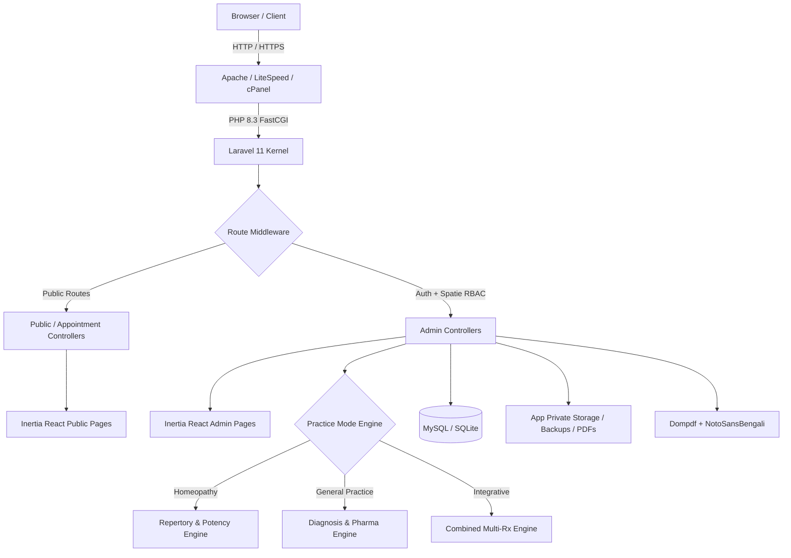

---

## 2. Receptionist & Patient Intake Journey (`[x] Done`)

Universal intake journey for all practice types (Homeopathy, General Practice, Dental, Polyclinic).

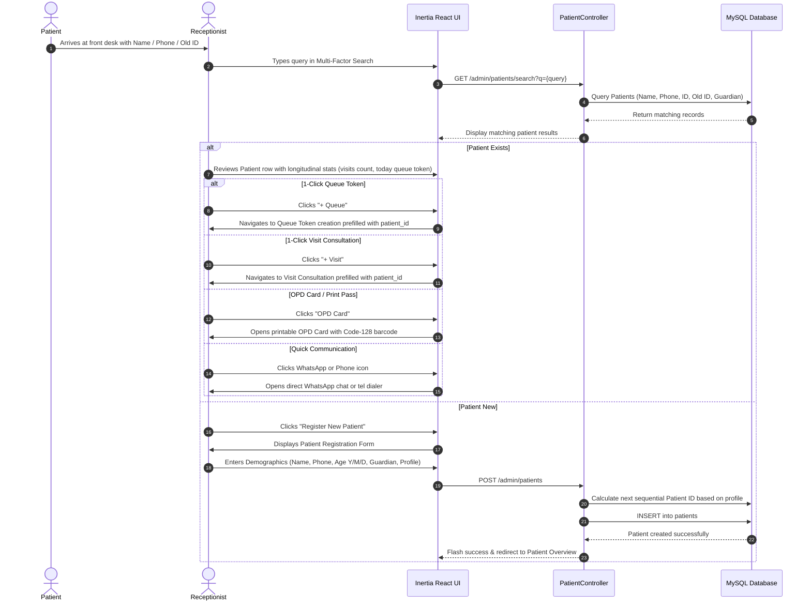

---

## 3. Dual Clinical Consultation Journeys

The doctor's consultation experience adapts dynamically to the clinic's configured practice mode or doctor specialty:

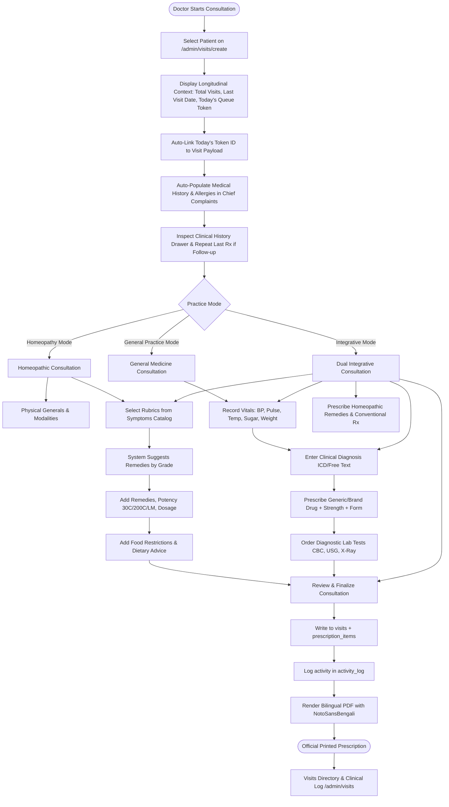

### 3.1 Post-Consultation Workflow & Visits Directory (`/admin/visits`)

Once finalized, the clinical encounter enters the central consultation directory:

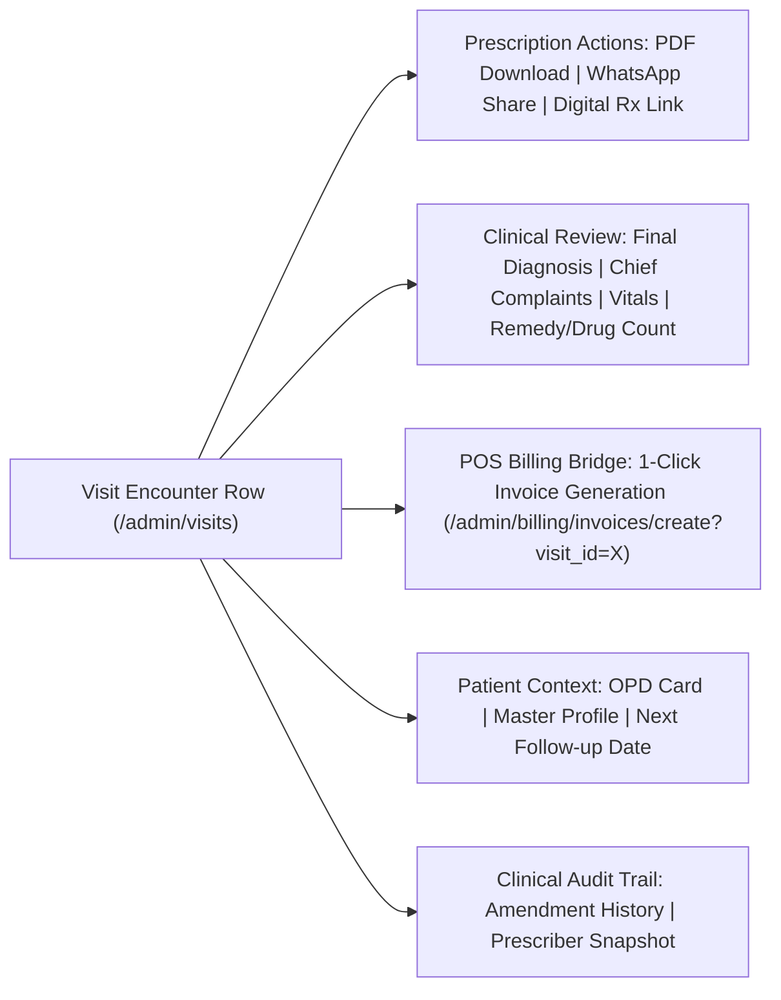

---

## 4. Prescription Amendment & Cancellation Workflow (`[x] Done`)

Preserves legal clinical integrity across all practice types.

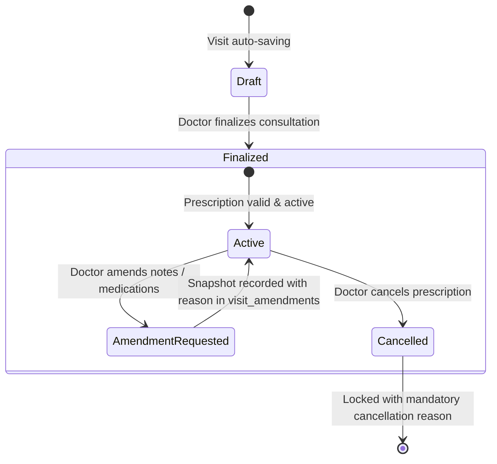

---

## 5. Online Appointment Request to Patient Conversion (`[x] Done`)

Unified appointment triage supporting doctors across all specialties.

### 5.1 Admin Appointment Requests & Triage Operations Flow (`/admin/appointment-requests`)

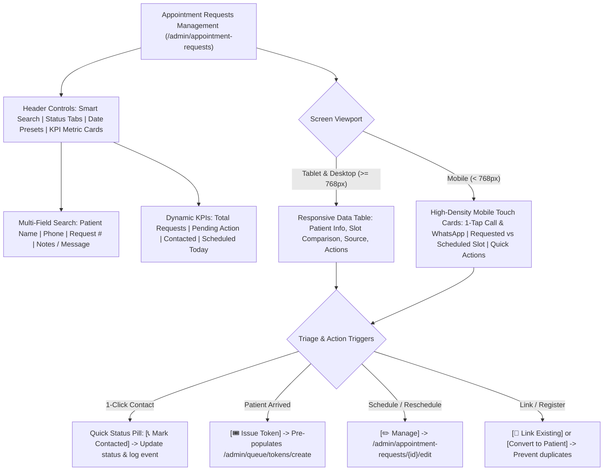

---

## 6. System Health, In-App Backup & Deployment Flow (`[x] Done`)

Server administration workflow tailored for cPanel hosting without SSH.

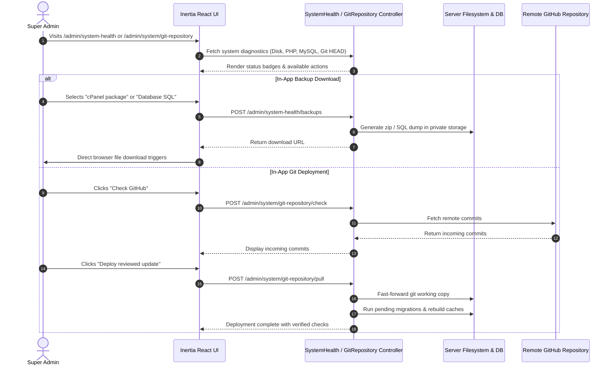

---

## 7. Pharmacy Dispensing & Inventory Deduction Flow (`[x] Done`)

Dual pharmacy dispensing workflow handling both homeopathic and conventional medications:

---

## 8. Billing, Invoicing & Cash Register Flow (`[x] Done`)

Universal point-of-sale workflow for consultation fees, medicines, and lab tests:

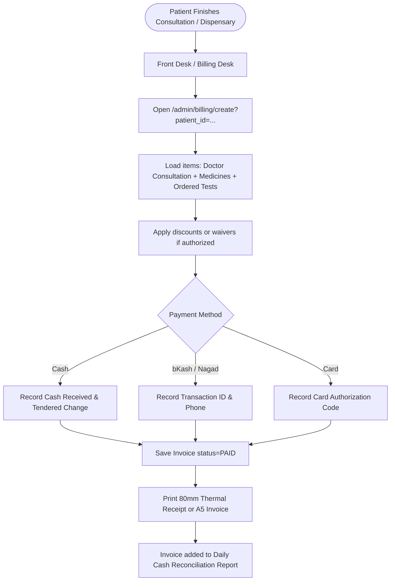

---

## 9. Patient Queue Management & Digital Signage Flow (`[x] Done`)

Waiting room live queue and digital TV display workflow:

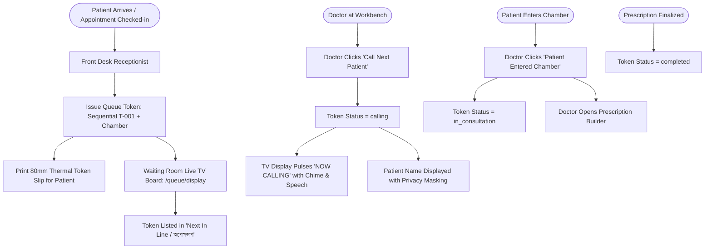

### 9.1 Multi-Screen Queue Operations & Reception Dashboard Flow (`/admin/queue`)

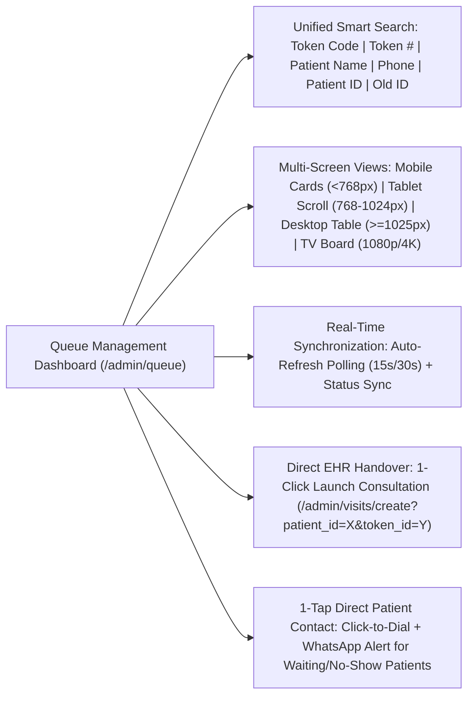

### 9.2 Token Issuance & Queue Check-in Flow (`/admin/queue/tokens/create`)

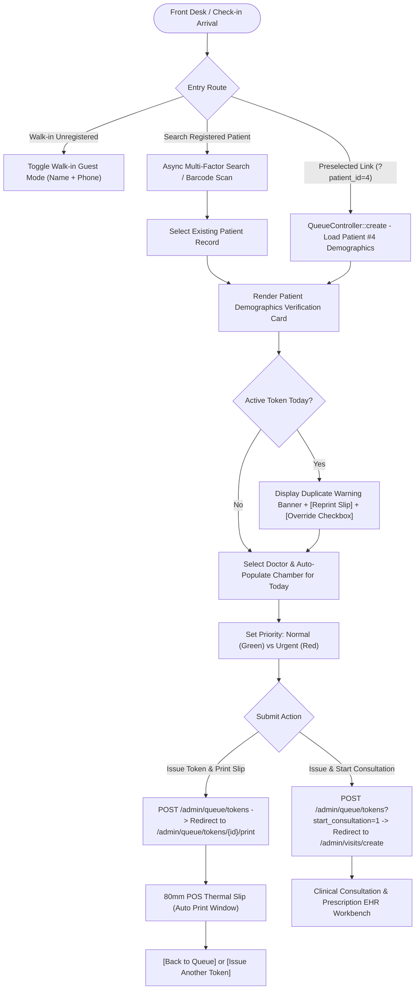

### 9.3 Doctor Schedules, Visual Calendar & Appointment Roster Flow (`/admin/calendar`)

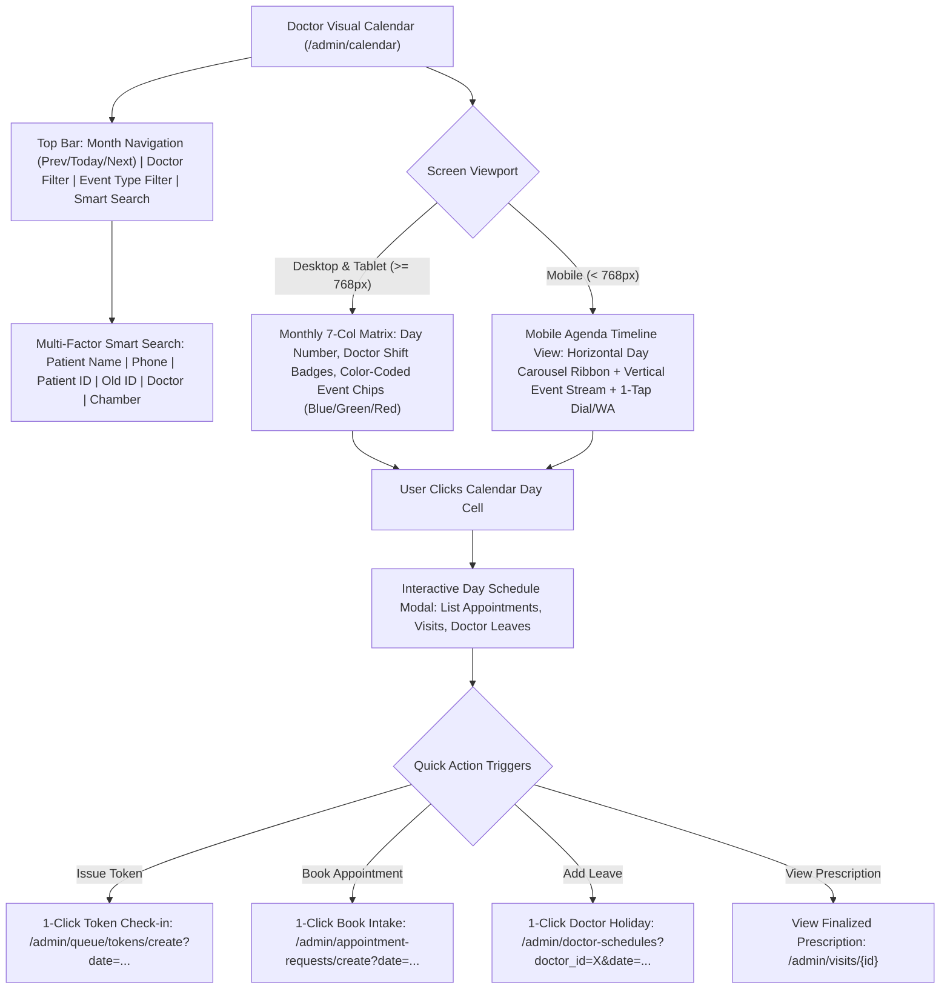

### 9.4 Doctor Visiting Hours, Chamber Roster & Leave Management Flow (`/admin/doctor-schedules`)

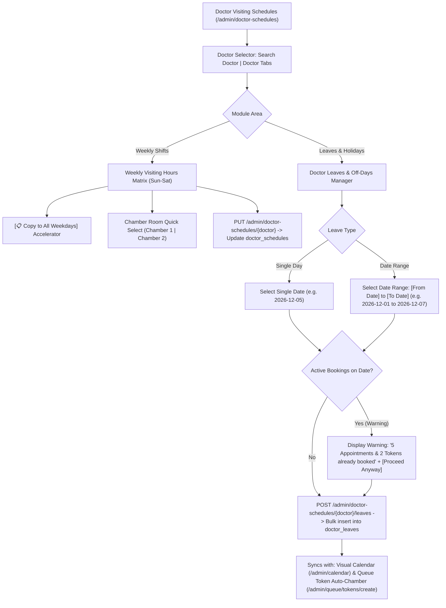

---

## 10. Automated Patient Communications Flow (`[x] Done`)

Multi-channel notification dispatches and public digital prescription access:

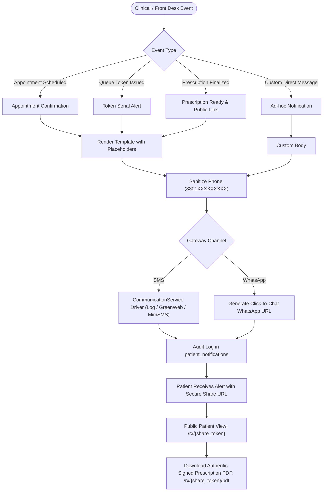
