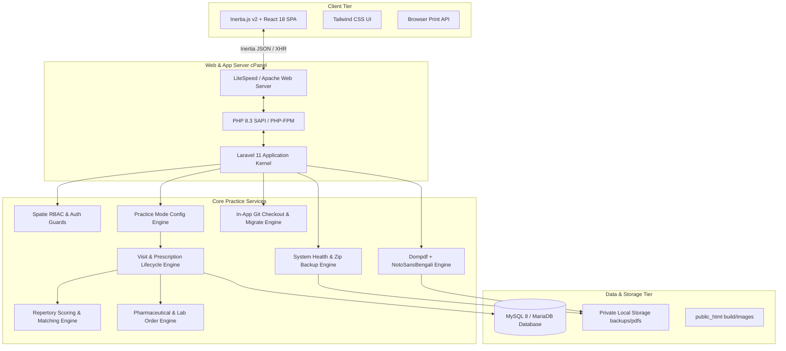

# Technical Requirements Document (TRD) (04_TRD.md)
## RemediQ - Dual-Purpose Practice Management System
*(Classical Homeopathy, General Medicine & Integrative Clinics)*

**Document Version:** 3.0  
**Backend Framework:** Laravel 11.x (PHP 8.3)  
**Frontend Framework:** Inertia.js v2 + React 18 + Vite 5 + Tailwind CSS v3/v4  
**Database:** MySQL 8.0+ / MariaDB 10.5+ (Production) | SQLite 3.35+ (Testing)  
**Target Hosting:** Shared cPanel Linux Hosting (LiteSpeed / Apache)  
**Status Legend:**  
- `[x] Done`: Implemented, tested, and active.  
- `[ ] Planned`: Planned technical architecture or enhancement.

---

## 1. System Architecture Overview



---

## 2. Practice Type Abstraction & Architecture

To support both **Classical Homeopathy** and **General Practice (Allopathy)** cleanly without code duplication, the platform implements an abstraction strategy:

### 2.1 Configuration
- `clinic_settings.practice_type`: Enum `['homeopathy', 'general_practice', 'integrative_dual']`.
- Individual `doctors` can also have an assigned `specialization_type` (e.g., Homeopath, General Physician, Pediatrician).

### 2.2 Data Model Adaptivity
- **Medication Items (`prescription_items`)**:
  - Universal columns: `visit_id`, `item_type` (`remedy` or `pharmaceutical`), `frequency`, `duration`, `instructions_en`, `instructions_bn`, `order_column`.
  - Homeopathy columns: `medicine_id` (foreign key to `medicines`), `remedy_name`, `potency` (e.g., 30C, 200C, LM-01), `dosage_form` (Pills, Dilution).
  - General Practice columns: `brand_name`, `generic_name`, `strength` (e.g., 500mg, 20mg/5ml), `dosage_form` (Tablet, Syrup, Injection).
- **Validation**: Dynamic validation in `VisitRequest` adjusting required fields based on `item_type`.

---

## 3. Server & Hosting Constraints (Shared cPanel)

### 3.1 Process & Execution Model
- **No Background Daemon**: Shared cPanel environments terminate unauthorized persistent daemon processes. Do not rely on persistent Node.js servers, Socket.io daemons, or long-running worker daemons.
- **Queue Execution**: Asynchronous queue processing uses the database driver (`QUEUE_CONNECTION=database`), driven by a cPanel scheduled cron job:
  ```bash
  * * * * * cd /home/username/clinic && php artisan schedule:run >> /dev/null 2>&1
  ```
- **Asset Bundling**: Webpack / Vite build tools run in the local development environment or CI pipeline (`npm run build`). Pre-compiled production bundles reside in `public/build`.
- **Directory Layout in cPanel**:
  - Application Core: `/home/username/clinic_core/` (outside public webroot).
  - Public Assets: `/home/username/public_html/` (contains `index.php`, `.htaccess`, `build/`, `favicon.ico`).

---

## 4. PDF Generation & Bengali Font Architecture

### 4.1 Technology Stack
- **Library**: `barryvdh/laravel-dompdf` (wrapping `dompdf/dompdf`).
- **Font Engine**: Custom TrueType Fonts embedded via CSS `@font-face`.
  - Regular: `NotoSansBengali-Regular.ttf`
  - Bold: `NotoSansBengali-Bold.ttf`
- **Storage Location**: `storage/fonts/` (pre-compiled font metrics cache).

### 4.2 Layout & Rendering Constraints
- **Table-Based Layout**: Dompdf does NOT reliably support CSS Flexbox or Grid. All PDF templates (`resources/views/pdf/prescription.blade.php`) use strict HTML `<table>` layouts with explicit widths.
- **UTF-8 Encoding**: The PDF HTML template MUST define:
  ```html
  <meta http-equiv="Content-Type" content="text/html; charset=utf-8"/>
  ```
- **Conjunct Ligature Preservation**: Text passed to Dompdf is normalized to Unicode NFC format to prevent broken Bengali glyphs.

---

## 5. Security & Hardening Specifications

### 5.1 Server-Side Authorization Boundaries
- Every administrative endpoint is protected by server-side middleware in `routes/admin.php`:
  - `role:Super Admin`: Dedicated to user management, roles, system health, and git deployment.
  - `permission:{resource}.{action}`: Enforced per HTTP verb (`patients.create`, `patients.update`, `visits.finalize`, etc.).
  - `clinical_records.view`: Mandatory gate for any visit or medical record reading.
- No client-side role check is trusted without server-side policy or middleware verification.

### 5.2 Super Admin Immutability
- The system enforces a strict invariant preventing the removal, deactivation, or demotion of the final remaining Super Admin.
- Super Admin permissions cannot be modified or revoked through the UI.

### 5.3 Rate Limiting Strategy
```php
// Public appointment intake
Route::post('/appointment-requests', [AppointmentRequestController::class, 'store'])
    ->middleware('throttle:5,1'); // 5 submissions per minute per IP

// System operations
Route::post('/system-health/backups', [SystemHealthController::class, 'backup'])
    ->middleware('system_health_backup_rate_limit');
Route::post('/system/git-repository/check', [...])
    ->middleware('throttle:6,1');
Route::post('/system/git-repository/database/migrate', [...])
    ->middleware('throttle:10,1');
```

---

## 6. Performance & Scalability Targets

| Metric | Target | Measurement Condition |
| :--- | :--- | :--- |
| **Search Autocomplete** | `< 120 ms` | Patient search query against 50,000 indexed records |
| **Visit Draft Auto-Save** | `< 80 ms` | Background PUT to `visit_drafts` table |
| **Prescription PDF Generation** | `< 450 ms` | Dompdf compilation of 2-page bilingual prescription |
| **Public Homepage TTFB** | `< 180 ms` | Cached public view on shared cPanel PHP 8.3 |
| **Max Concurrent Consultations** | 25 doctors | Standard cPanel hosting (2 CPU cores, 2 GB RAM) |
